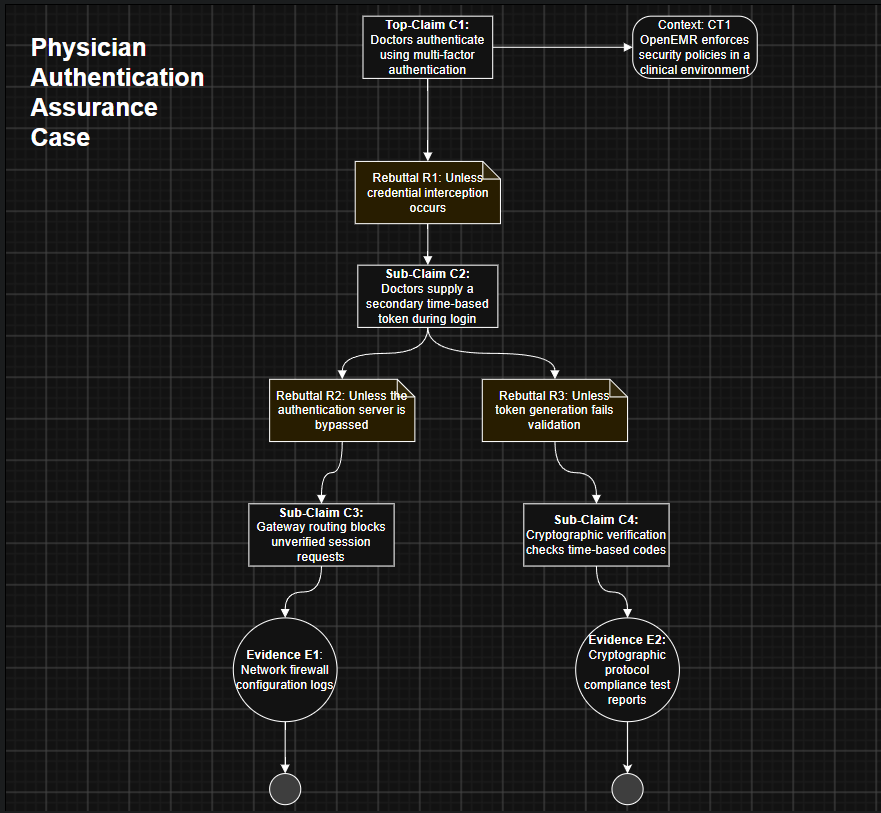
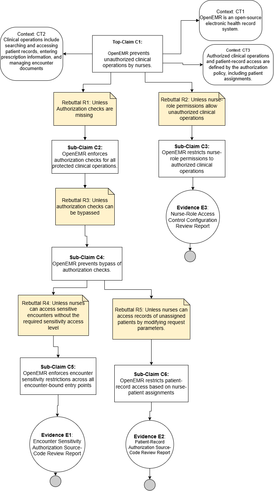
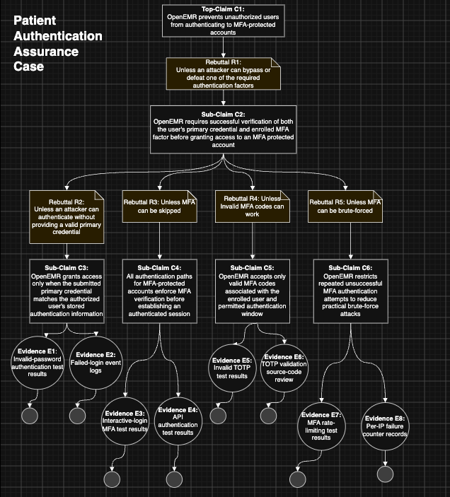

# OpenEMR Security Assurance Case and Evidence-Gap Analysis

## Team Assurance Case Overview

This analysis evaluates security properties of OpenEMR through five assurance cases developed by individual team members. Each assurance case identifies a top-level security claim, potential rebutting defeaters, supporting sub-claims or counterclaims, and planned evidence that could be used to provide assurance that the security property is satisfied.

Part 2 compares the planned evidence with evidence available or capable of being produced from the OpenEMR project and identifies gaps where additional configuration review, testing, or security assessment would be necessary.

---

# Part 1 – Assurance Cases

## 1. Unauthorized Access Assurance Case – Seth

### Top-Level Claim

**C1:** OpenEMR sufficiently prevents unauthorized access to protected system resources.

This assurance case addresses repeated credential-guessing and credential-stuffing attempts, compromised user passwords, and authenticated users accessing resources beyond their assigned privileges.

### Assurance Case Diagram

### Argument Summary

The top-level claim is supported by two sub-claims. The first addresses unauthorized users attempting to gain access through protected user accounts. The second addresses authenticated users attempting to access resources outside their authorized privileges.

The assurance case considers three rebutting defeaters:

- **R1:** Unless an attacker succeeds through repeated credential-guessing or credential-stuffing attempts.
- **R2:** Unless an attacker obtains valid credentials for a protected user account.
- **R3:** Unless an authenticated user can access resources beyond their assigned privileges.

These rebuttals are addressed through counterclaims concerning restrictions on repeated authentication attempts, multi-factor authentication, and role- and privilege-based access controls. Planned evidence E1 through E9 provides the basis for evaluating these counterclaims.

---

## 2. Physician Authentication Assurance Case – Jacob

### Top-Level Claim

**C1:** Doctors authenticate using multi-factor authentication.

**Context CT1:** OpenEMR enforces security policies in a clinical environment.

### Assurance Case Diagram

### Argument Summary

The assurance case includes the following argument:

- **R1:** Unless credential interception occurs.
- **C2:** Doctors supply a secondary time-based token during login.
- **R2:** Unless the authentication server is bypassed.
- **R3:** Unless token generation fails validation.
- **C3:** Gateway routing blocks unverified session requests.
- **C4:** Cryptographic verification checks time-based codes.

### Planned Evidence

- **E1:** Network firewall configuration logs.
- **E2:** Cryptographic protocol compliance test reports.

---

## 3. Nurse Authorization Assurance Case – Mai

### Top-Level Claim

**C1:** OpenEMR prevents unauthorized clinical operations by nurses.

### Context

- **CT1:** OpenEMR is an open-source electronic health record system.
- **CT2:** Clinical operations include searching and accessing patient records, entering prescription information, and managing encounter documents.
- **CT3:** Authorized clinical operations and patient-record access are defined by the authorization policy, including patient assignments.

### Assurance Case Diagram

### Supporting Claims

- **C2:** OpenEMR enforces authorization checks for all protected clinical operations.
- **C3:** OpenEMR restricts nurse-role permissions to authorized clinical operations.
- **C4:** OpenEMR prevents bypass of authorization checks.
- **C5:** OpenEMR enforces encounter sensitivity restrictions across all encounter-bound entry points.
- **C6:** OpenEMR restricts patient-record access based on nurse-patient assignments.

### Rebutting Defeaters

- **R1:** Unless authorization checks are missing.
- **R2:** Unless nurse-role permissions allow unauthorized clinical operations.
- **R3:** Unless authorization checks can be bypassed.
- **R4:** Unless nurses can access sensitive encounters without the required sensitivity access level.
- **R5:** Unless nurses can access records of unassigned patients by modifying request parameters.

### Planned Evidence

- **E1:** Encounter Sensitivity Authorization Source-Code Review Report.
- **E2:** Patient-Record Authorization Source-Code Review Report.
- **E3:** Nurse-Role Access Control Configuration Review Report.

---

## 4. Patient Authentication Assurance Case – Trey

### Top-Level Claim

**C1:** OpenEMR prevents unauthorized users from authenticating to MFA-protected accounts.

### Assurance Case Diagram

### Argument Summary

**R1:** Unless an attacker can bypass or defeat one of the required authentication factors.

**C2:** OpenEMR requires successful verification of both the user's primary credential and enrolled MFA factor before granting access to an MFA-protected account.

#### Primary Credential

- **R2:** Unless an attacker can authenticate without providing a valid primary credential.
- **C3:** OpenEMR grants access only when the submitted primary credential matches the authorized user's stored authentication information.
- **E1:** Invalid-password authentication test results.
- **E2:** Failed-login event logs.

#### MFA Enforcement

- **R3:** Unless MFA can be skipped.
- **C4:** All authentication paths for MFA-protected accounts enforce MFA verification before establishing an authenticated session.
- **E3:** Interactive-login MFA test results.
- **E4:** API authentication test results.

#### MFA Code Validation

- **R4:** Unless invalid MFA codes can work.
- **C5:** OpenEMR accepts only valid MFA codes associated with the enrolled user and permitted authentication window.
- **E5:** Invalid TOTP test results.
- **E6:** TOTP validation source-code review.

#### MFA Brute-Force Protection

- **R5:** Unless MFA can be brute-forced.
- **C6:** OpenEMR restricts repeated unsuccessful MFA authentication attempts to reduce practical brute-force attacks.
- **E7:** MFA rate-limiting test results.
- **E8:** Per-IP failure counter records.

---

## 5. Prescription Exchange Integrity Assurance Case – Erik

### Top-Level Claim

**C1:** OpenEMR's prescription exchange prevents unauthorized data modification.

### Assurance Case Diagram

### Supporting Claims

- **C1.1:** External pharmacy systems are authenticated and authorized before prescription transactions are accepted.
- **C1.2:** Prescription information is protected against undetected modification while transmitted between OpenEMR and external pharmacy systems.
- **C1.3:** Externally supplied prescription data is processed without permitting unauthorized changes to prescription state.
- **C1.4:** Prescription creation, modification, transmission, and refill activity is sufficiently auditable to identify integrity violations.

### Planned Evidence

#### C1.1 – Pharmacy Authentication and Authorization

- **E1:** Pharmacy identity and authorization configuration.
- **E2:** API authentication configuration.
- **E3:** Pharmacy authorization test results.
- **E4:** Access-control test report.

#### C1.2 – Prescription Transmission

- **E5:** TLS configuration baseline.
- **E6:** Certificate-validation test results.
- **E7:** Prescription transmission integrity test results.

#### C1.3 – Prescription Processing

- **E8:** Parameterized-query static-analysis report.
- **E9:** Input-validation test results.
- **E10:** SQL-injection penetration-test results.
- **E11:** Authorization-negative test results.

#### C1.4 – Prescription Auditing

- **E12:** Prescription audit-log sample.
- **E13:** Audit-log completeness test results.
- **E14:** Audit-event configuration.
- **E15:** Prescription transaction trace.

### Rebutting Defeaters

**R1:** A compromised pharmacy credential could permit a fraudulent refill request.

**Counterclaim:** Compromised credentials alone are insufficient to authorize unauthorized prescription changes.

**Planned Evidence:**

- Credential-revocation test results.
- Pharmacy authorization test results.
- High-risk transaction test results.

**R2:** An authenticated pharmacy system could attempt a prescription change outside its authorized scope.

**Counterclaim:** Prescription operations are restricted according to the requesting system's assigned permissions and transaction context.

**Planned Evidence:**

- Pharmacy privilege matrix.
- Negative authorization test results.
- API access-control test report.

---

# Part 2 – OpenEMR Evidence Assessment and Gap Analysis

## 1. Seth – Unauthorized Access

### Gap 1: Authentication Protection Evidence (E1–E3)

**Gap:** OpenEMR provides mechanisms for tracking and restricting repeated failed authentication attempts, and project documentation and source code provide evidence that these protections are implemented. However, the project materials examined do not fully provide the deployment-specific configuration records, executed failed-login test results, or credential-stuffing penetration-test results identified as Evidence E1–E3 in the assurance case.

**Bridging Effort:** A representative OpenEMR deployment should be configured with appropriate failed-login restrictions and tested using controlled authentication attempts. Configuration records should document the enabled thresholds, while functional testing should verify that repeated unsuccessful login attempts trigger the expected restrictions. An authorized credential-stuffing test using synthetic accounts and credentials could provide additional evidence that the controls resist repeated credential-based attacks.

### Gap 2: Multi-Factor Authentication Evidence (E4–E6)

**Gap:** OpenEMR provides multi-factor authentication functionality, which supports the assurance argument that a compromised password alone can be insufficient to access a protected account. However, the existence of MFA functionality does not demonstrate that MFA is enabled for applicable accounts or provide the configuration and executed test results represented by Evidence E4–E6.

**Bridging Effort:** MFA should be enabled for representative protected accounts in an OpenEMR test environment. Configuration records should document MFA enrollment and enforcement. Testing should attempt authentication with a valid password but without the required secondary factor and verify that access is denied. Additional testing should verify that valid MFA responses are accepted and invalid responses are rejected.

### Gap 3: Authorization and Access-Control Evidence (E7–E9)

**Gap:** OpenEMR provides role- and privilege-based access-control mechanisms for restricting authenticated users. These mechanisms provide implementation evidence supporting the assurance case, but they do not independently establish that roles follow least privilege or that users cannot bypass authorization restrictions. The project materials examined do not fully provide the deployment-specific role configuration, access-control test results, or penetration-test results represented by Evidence E7–E9.

**Bridging Effort:** Representative user roles should be configured with documented privileges and tested against protected OpenEMR resources. Testing should verify that authorized operations succeed while operations outside the user's assigned privileges are denied. Authorized security testing should also attempt restricted-resource access and privilege escalation to determine whether access-control restrictions can be bypassed.

---

## 2. Jacob – Physician Authentication

### Gap 1: Network Perimeter and Infrastructure Evidence (E1)

**Gap:** OpenEMR functions primarily as a PHP/MySQL web application package rather than a network appliance. While its code enforces TLS/HTTPS for OAuth 2.0 and OIDC API endpoints, OpenEMR itself does not natively generate firewall configuration logs or packet-filtering audit trails.

**Bridging Effort:** To satisfy Evidence E1 in an operational environment, the deploying organization would need to place OpenEMR behind a reverse proxy, such as Nginx or Apache, or a cloud-native Web Application Firewall and configure centralized logging to collect perimeter routing information.

### Gap 2: Formal Cryptographic Compliance Test Reports (E2)

**Gap:** OpenEMR implements TOTP functionality for authentication. However, the open-source project repository does not provide the formal cryptographic compliance test reports identified as planned evidence in the assurance case.

**Bridging Effort:** The adopting organization would need to perform internal or third-party testing and cryptographic validation against the OpenEMR authentication interface to generate formal evidence demonstrating appropriate rejection of invalid, expired, or replayed authentication tokens.

---

## 3. Mai – Nurse Authorization

OpenEMR documentation describes access controls for sensitive encounters and encounter-sensitivity authorization checks. The evidence gap is that the existence of these controls does not establish that sensitivity authorization checks are consistently applied across all encounter-bound form entry points. Additional assessment would be necessary to verify that users without the required sensitivity access level cannot view or modify protected encounter information.

OpenEMR also provides a patient privacy module that supports assigning patients to clinicians. However, the existence of this functionality does not establish that a particular deployment is configured according to the principle of least privilege. Additional configuration review and testing would be necessary to determine whether patient assignments appropriately restrict access to patient records.

---

## 4. Trey – Patient Authentication

The primary gap in the Patient Authentication assurance case is that the existence of security features does not necessarily prove their effectiveness in every authentication scenario. Additional testing would be required to verify that incorrect passwords, expired or reused MFA codes, and repeated authentication attempts are consistently rejected.

Another significant gap involves MFA enforcement. If a healthcare organization does not require MFA for patients accessing the patient portal or other protected resources, the presence of MFA functionality alone does not provide assurance that patient accounts receive the intended protection. Deployment-specific configuration evidence would therefore be necessary to establish that MFA is appropriately enforced.

---

## 5. Erik – Prescription Exchange Integrity

| Planned Evidence | Availability/Alignment | Gap Assessment |
|---|---|---|
| Pharmacy identity and authorization configuration | Partially aligned | Significant gap — prior work found pharmacy authentication only partially supported |
| API authentication configuration | Can likely be collected from OpenEMR configuration/documentation | Needs collection and verification |
| Pharmacy authorization test results | Not presently in team evidence | Requires additional testing |
| Access-control test report | RBAC capability exists | Requires pharmacy-specific validation |
| TLS configuration baseline | TLS is supported | Deployment-specific evidence must be collected |
| Certificate-validation test results | Not currently available | Requires testing |
| Prescription transmission integrity test results | Not currently available | Requires end-to-end testing |
| Parameterized-query static-analysis report | Secure-coding support identified | Requires endpoint-specific analysis |
| SQL-injection penetration-test results | Not currently available | Requires security testing |
| Authorization-negative test results | Not currently available | Requires security testing |
| Prescription audit-log sample | Audit capability exists | Requires configured OpenEMR instance and transaction |
| Audit-log completeness test results | Not currently available | Requires validation against expected events |
| Pharmacy privilege matrix | Not presently documented in team evidence | Requires documentation/collection |
| Credential-revocation test results | Not presently available | Requires additional testing |

---

# AI Prompt and Reflection

As part of developing the team's assurance cases, AI was used as a supporting tool to help evaluate and improve claim structures. One example involved using AI to develop an assurance case based on the nurse-role misuse case created during the previous assignment.

## Example AI Prompt

> Using the nurse-role misuse case previously developed for OpenEMR, generate an assurance case that includes a top-level security claim, supporting claims, rebutting defeaters, and evidence that could be used to support the claims.

## Team Reflection on AI Use

The AI-generated response provided useful direction for developing the assurance case and helped identify possible claims, defeaters, and supporting evidence. However, the generated material still required review against the assurance-case requirements provided in the assignment. For example, one generated top-level claim used a compound predicate, which did not follow the desired claim structure.

This demonstrated that AI can be useful for brainstorming and reviewing assurance-case arguments, but its suggestions should not automatically be accepted as correct. The team found that the most useful approach was to use AI for ideas and refinement while evaluating the results against the assignment requirements and making the final decisions ourselves.

---

# Individual Team Member Reflections

## Seth

I learned that an assurance case requires more than identifying security controls. Developing the claims, rebuttals, and evidence helped me understand how you can challenge a security claim and determine what evidence would actually be needed to support it.
I found the evidence portion the most useful because it showed the difference between knowing a security feature exists and having evidence that it actually works as intended. This assignment also helped me see how the misuse cases from our previous assignment connect to the assurance-case process.

## Jacob

One piece that I found useful in this assignment in particular was going through the NIST SP 800-63B section about multi-factor authentication. This helped me get the foundational knowledge to develop my claim.

## Mai

I honestly enjoyed this part of the assignment; it challenged me. Exploring assurance cases and writing a strong claim was new to me. I liked coming up with a claim, challenging it, and then supporting it with evidence.

This topic is a good way to start questioning the security of software and asking how secure it is and what kinds of weaknesses could impact it. After working on this part of the assignment, I started connecting what we did throughout the semester and how it all makes sense.

## Trey

I learned from this assignment that once you do the legwork on misuse cases, it is pretty simple to take that and build out an assurance case from it. I feel like the diagramming is a lot easier for assurance cases, and overall I thought it was a good exercise in getting to fully understand the problem-solving process and what users are thinking when we would present something to them.

## Erik

This assignment helped me understand the difference between identifying security controls and developing assurance that those controls actually provide the intended security property. In the previous misuse-case assignment, I identified threats to the external pharmacy workflow and mitigating controls in place to protect against them. Building an assurance case required me to go one step further and determine what tangible evidence would be necessary to convince a stakeholder that those controls actually protect prescription integrity.

I found the use of claims, rebuttals, and measurable evidence particularly useful because it is similar to risk-assessment work but provides clearer traceability between a security assertion and the evidence needed to support it.

---

# Team Reflection

As a team, we learned that developing an assurance case requires more than identifying security controls or describing how a system is intended to operate. Each security claim must be challenged by considering circumstances under which it may fail, and those challenges must then be addressed using supporting claims and tangible evidence.

A recurring lesson across the team's assurance cases was the distinction between the existence of a security mechanism and evidence demonstrating its effectiveness. OpenEMR documentation and source code can establish that authentication, multi-factor authentication, authorization, auditing, and other security mechanisms exist, but additional configuration review and testing may still be required to demonstrate that those mechanisms provide the intended security properties in a particular deployment.

The team also found the connection between the previous misuse-case analysis and the assurance-case process useful. Threats and security requirements identified during misuse-case analysis provided a foundation for developing assurance claims, rebutting those claims, and determining what evidence would be needed to support them.

---

# OpenEMR Evidence Sources

1. **OpenEMR Authentication Documentation**  
   https://github.com/openemr/openemr/blob/master/Documentation/api/AUTHENTICATION.md

2. **OpenEMR AuthUtils.php**  
   https://github.com/openemr/openemr/blob/master/src/Common/Auth/AuthUtils.php

3. **OpenEMR Authorization and Scopes**  
   https://github.com/openemr/openemr/blob/master/Documentation/api/AUTHORIZATION.md

4. **OpenEMR Access Controls Listing**  
   https://www.open-emr.org/wiki/index.php/Access_Controls_Listing

5. **OpenEMR ePrescribe**  
   https://www.open-emr.org/wiki/index.php/OpenEMR_ePrescribe

6. **OpenEMR Standard API Documentation**  
   https://github.com/openemr/openemr/blob/master/Documentation/api/STANDARD_API.md

7. **OpenEMR Codebase Security**  
   https://www.open-emr.org/wiki/index.php/Codebase_Security

8. **Auditing in OpenEMR**  
   https://www.open-emr.org/wiki/index.php/3.1_Auditing_in_OpenEMR
