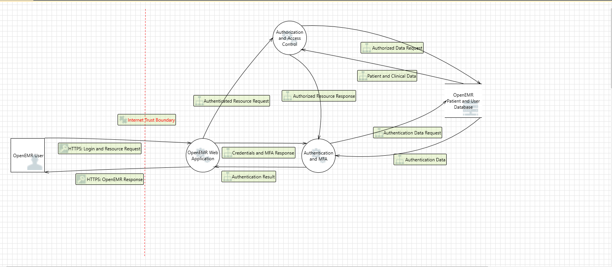
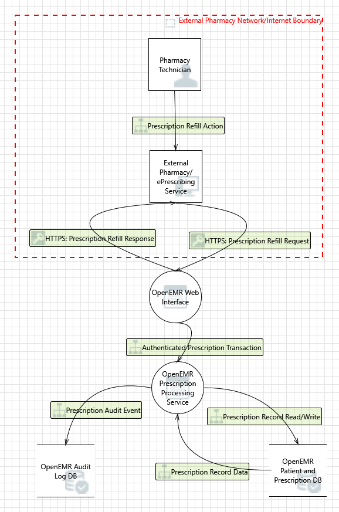

# OpenEMR Threat Modeling Analysis

## Team Members

- Seth Stutzman
- Mai Abdalla
- Trey Moore
- Jacob Linke
- Erik Osmera

---

# Part 1 – Threat Modeling

## Overview

For this assignment, the team developed Data Flow Diagrams (DFDs) representing critical data flows associated with the OpenEMR security scenarios examined in our previous Security Requirements and Assurance Case assignments.

The DFDs were developed and analyzed using the Microsoft Threat Modeling Tool. Automatically generated threats were reviewed using the STRIDE threat categories:

- Spoofing
- Tampering
- Repudiation
- Information Disclosure
- Denial of Service
- Elevation of Privilege

Particular attention was given to interactions crossing trust boundaries. Identified threats were reviewed to determine whether OpenEMR contains relevant mitigation mechanisms and whether sufficient evidence exists to consider those threats mitigated.

---

# DFD 1 – Authentication and Authorized Resource Access

## Scenarios Covered

This DFD supports the team's OpenEMR scenarios involving:

- Unauthorized access prevention
- User authentication
- Multi-factor authentication
- Authorization and privilege enforcement
- Patient and clinical resource access

The DFD relates to scenarios previously examined by:

- **Seth** – Unauthorized Access / Authentication and Authorization
- **Jacob** – Physician MFA
- **Trey** – Patient MFA
- **Mai** – Nurse Authorization / Patient Record Access

---

## DFD Description

The Authentication and Authorized Resource Access DFD models how an OpenEMR user authenticates to the application and subsequently requests access to protected OpenEMR resources.

The **OpenEMR User** exists outside the **Internet Trust Boundary** and communicates with the **OpenEMR Web Application** using HTTPS.

Authentication information is passed to the **Authentication and MFA** process. Authentication data needed to validate the user is retrieved from the **OpenEMR Patient and User Database**, and the resulting authentication status is returned to the web application.

After authentication, protected resource requests are sent to the **Authorization and Access Control** process. The authorization process determines whether the authenticated user is permitted to access the requested information before retrieving patient or clinical data from the database.

Authorized information is then returned through the OpenEMR Web Application to the user over HTTPS.

---

## DFD Components

### External Interactor

**OpenEMR User**

Represents a person attempting to authenticate to OpenEMR and access protected application resources.

### Processes

**OpenEMR Web Application**

Receives requests from the user and coordinates authentication and protected-resource access.

**Authentication and MFA**

Represents the authentication process, including credential validation and applicable multi-factor authentication.

**Authorization and Access Control**

Represents authorization decisions that determine whether an authenticated user is permitted to access a requested OpenEMR resource.

### Data Store

**OpenEMR Patient and User Database**

Represents stored authentication, user, patient, and clinical information required by the modeled processes.

### Trust Boundary

**Internet Trust Boundary**

Separates the external OpenEMR user from the OpenEMR application environment.

---

## Data Flows

The DFD contains the following data flows:

1. `HTTPS: Login and Resource Request`
2. `Credentials and MFA Response`
3. `Authentication Data Request`
4. `Authentication Data`
5. `Authentication Result`
6. `Authenticated Resource Request`
7. `Authorized Data Request`
8. `Patient and Clinical Data`
9. `Authorized Resource Response`
10. `HTTPS: OpenEMR Response`

The two HTTPS flows cross the Internet Trust Boundary.

---

## DFD Diagram

---

## Microsoft Threat Modeling Tool Analysis

The Microsoft Threat Modeling Tool generated **23 potential threats** for the Authentication and Authorized Resource Access DFD.

### Threat Summary

| Status | Count |
|---|---:|
| Not Started | 0 |
| Not Applicable | 0 |
| Needs Investigation | 23 |
| Mitigation Implemented | 0 |
| **Total** | **23** |

Each automatically generated threat was reviewed to determine whether OpenEMR provides a relevant security control and whether sufficient evidence exists to classify the threat as mitigated.

Although OpenEMR provides numerous security controls applicable to the identified threats, the analysis determined that additional implementation, configuration, or security-testing evidence would be necessary to demonstrate complete mitigation.

Therefore, all 23 threats were retained as **Needs Investigation**.

---

## Threat Review

The generated threats addressed risks involving:

- User spoofing
- Authentication and identity impersonation
- Database spoofing
- Excessive resource consumption
- Cross-Site Request Forgery
- Modification of application execution flow
- Remote code execution
- Interruption of requests and responses
- Application availability
- Repudiation
- Weak access controls
- Authorization-related privilege escalation
- Protection of patient and clinical information

OpenEMR contains controls relevant to many of these threats. These include authentication and MFA capabilities, failed-login protections, session-management controls, access-control mechanisms, CSRF protections, auditing, and application-security controls.

However, the existence of a security mechanism does not by itself demonstrate that the mechanism is correctly configured and consistently enforced throughout every applicable OpenEMR workflow.

For this reason, the team avoided classifying threats as **Mitigation Implemented** solely because a corresponding security feature exists.

---

## Full TMT HTML Report

[OpenEMR Authentication and Authorized Resource Access – Full TMT Report](https://htmlpreview.github.io/?https://raw.githubusercontent.com/S3THs00/Group-Project-8420/refs/heads/main/OpenEMR_Authentication_Threat_Model_Report.htm)

---

# DFD 2 – External Pharmacy Prescription Exchange

## Scenario Covered

- ePrescription / External Pharmacy communication

**Primary contributor: Erik Osmera**

---

## DFD Description

The External Pharmacy Prescription Exchange DFD models prescription and refill transactions between an external pharmacy or ePrescribing service and OpenEMR.

The model examines communication between the external pharmacy/ePrescribing environment and OpenEMR, including prescription and refill information exchanged across the external trust boundary.

**[ERIK – REVIEW THIS DESCRIPTION AND ADD OR CORRECT DETAILS FROM YOUR FINAL DFD IF NECESSARY]**

---

## DFD Diagram

---

## Microsoft Threat Modeling Tool Analysis

Erik's Microsoft Threat Modeling Tool analysis identified **21 potential threats**.

### Threat Summary

| Status | Count |
|---|---:|
| Not Started | 0 |
| Not Applicable | 3 |
| Needs Investigation | 16 |
| Mitigation Implemented | 2 |
| **Total** | **21** |

**[ERIK – ADD A SHORT SUMMARY OF THE MOST IMPORTANT THREATS, MITIGATIONS, AND REASONS FOR ANY THREATS MARKED NOT APPLICABLE OR MITIGATION IMPLEMENTED]**

---

## Full TMT HTML Report

[OpenEMR External Pharmacy Prescription Exchange – Full TMT Report](https://htmlpreview.github.io/?https://raw.githubusercontent.com/S3THs00/Group-Project-8420/refs/heads/main/Full.Report.Pharmacy.TMT.htm)

---

# Additional Team Threat-Modeling Analysis

The Authentication and Authorized Resource Access DFD covers several of the team's previously developed security scenarios. Team members should add findings from their individual analysis that are not already represented above.

## Mai – Nurse Authorization / Patient Record Access

**[MAI – ADD YOUR THREAT-MODELING ANALYSIS/FINDINGS HERE. INCLUDE THE RELEVANT SCENARIO, IMPORTANT THREATS, MITIGATIONS, AUTHORIZATION OR PATIENT-ACCESS FINDINGS, AND ANYTHING ELSE FROM YOUR WORK THAT SHOULD APPEAR IN THE FINAL SUBMISSION.]**

## Trey – Patient MFA

**[TREY – ADD YOUR THREAT-MODELING ANALYSIS/FINDINGS HERE. INCLUDE THE RELEVANT SCENARIO, IMPORTANT THREATS, MITIGATIONS, MFA/AUTHENTICATION FINDINGS, AND ANYTHING ELSE FROM YOUR WORK THAT SHOULD APPEAR IN THE FINAL SUBMISSION.]**

## Jacob – Physician MFA

**[JACOB – ADD YOUR THREAT-MODELING ANALYSIS/FINDINGS HERE. INCLUDE THE RELEVANT SCENARIO, IMPORTANT THREATS, MITIGATIONS, MFA/AUTHENTICATION FINDINGS, AND ANYTHING ELSE FROM YOUR WORK THAT SHOULD APPEAR IN THE FINAL SUBMISSION.]**

---

# Part 2 – Observations

## OpenEMR Security Mitigation Review

The team reviewed OpenEMR to determine whether security controls expected from the DFD-based threat analysis were present.

OpenEMR provides numerous security mechanisms relevant to threats identified during the analysis, including authentication controls, multi-factor authentication, failed-login protections, session-management controls, role- and privilege-based access controls, CSRF protections, auditing capabilities, and API authentication and authorization controls.

However, the existence of a security mechanism does not by itself demonstrate that every applicable threat is completely mitigated. Some controls depend on deployment configuration, while others must be consistently enforced throughout the application.

For this reason, threats were not classified as fully mitigated without sufficient supporting evidence.

---

## Authentication and MFA

OpenEMR provides authentication mechanisms and supports MFA. It also contains protections associated with repeated failed authentication attempts.

These mechanisms help address spoofing and authentication-related threats identified in the DFD. However, MFA can depend on configuration and enrollment rather than necessarily being universally enforced for every OpenEMR user and deployment.

This demonstrates an important difference between a **security capability being available** and a **security requirement being consistently enforced**.

---

## Authorization and Patient Data Access

OpenEMR implements access-control mechanisms designed to restrict application functionality and access to protected clinical information according to user permissions.

These mechanisms are relevant to threats involving unauthorized access to patient and clinical data. However, access-control mechanisms must be correctly configured and consistently enforced at applicable application endpoints.

The team's analysis therefore determined that authorization-related threats require verification rather than assuming that the presence of an access-control framework completely mitigates unauthorized-access risks.

---

## Input Validation and Application Security

The threat model identified risks involving malicious input, modification of application execution, and potential remote code execution.

Although OpenEMR contains security mechanisms intended to reduce these risks, implementation-level vulnerabilities can still occur. OpenEMR security advisories demonstrate that security vulnerabilities can require remediation even when broader security frameworks and controls exist.

Input validation, secure coding practices, source-code review, vulnerability testing, and penetration testing therefore remain important methods of verifying these mitigations.

---

## CSRF and Session Security

OpenEMR includes mechanisms for protecting authenticated sessions and preventing Cross-Site Request Forgery (CSRF).

The effectiveness of these controls depends on their consistent implementation throughout applicable application functionality. The existence of a CSRF protection mechanism, for example, does not independently establish that every applicable state-changing operation properly enforces that protection.

The associated threats therefore require verification rather than automatically being considered fully mitigated.

---

## Auditing and Repudiation

OpenEMR provides auditing and logging capabilities for security-relevant activity.

These mechanisms can help provide accountability for authentication and protected-resource activity. However, the effectiveness of auditing depends on which events are recorded, the information contained in those records, system configuration, and protection of the audit information.

Audit-log verification would therefore be necessary to establish whether all modeled activities provide sufficient accountability to address repudiation threats.

---

## Availability and Resource Consumption

The threat model identified denial-of-service risks involving excessive authentication or database requests, application resource exhaustion, and interruption of HTTPS communications.

OpenEMR includes controls relevant to some of these threats, including protections associated with repeated failed authentication attempts. These mechanisms can reduce specific forms of abusive authentication activity but do not establish complete protection against application-level, database-level, network-level, or infrastructure-level denial-of-service attacks.

Deployment-specific protections such as server configuration, network controls, resource limits, monitoring, and availability architecture would need to be examined before these threats could be considered fully mitigated.

---

## Trust Boundary Observations

Particular attention was given to interactions crossing trust boundaries.

In the Authentication and Authorized Resource Access DFD, the user's login and resource request enters OpenEMR across the **Internet Trust Boundary**. The resulting OpenEMR response crosses the same boundary when information is returned to the user.

HTTPS/TLS provides important protection for information while it is transmitted. However, transport encryption alone does not eliminate threats involving:

- Compromised credentials
- User impersonation
- Malicious requests
- Session misuse
- Denial of service
- Application vulnerabilities

This demonstrates the importance of applying multiple complementary security controls to interactions crossing a trust boundary.

**[ERIK – ADD ANY IMPORTANT TRUST-BOUNDARY OBSERVATIONS FROM THE EXTERNAL PHARMACY DFD]**

---

## Identified Gaps

The primary gap identified during the review was not necessarily the absence of security mechanisms, but the difficulty of demonstrating that those mechanisms are **configured, consistently enforced, and effective for every applicable OpenEMR workflow**.

OpenEMR contains controls addressing many of the STRIDE threats generated by the Microsoft Threat Modeling Tool. However, additional evidence would be required before the team could confidently classify all applicable threats as fully mitigated.

Useful additional evidence could include:

- Authentication and MFA enforcement testing
- Authorization and access-control testing
- Configuration reviews
- Source-code review
- Penetration testing
- Audit-log verification
- Testing with malformed requests
- Testing with excessive requests
- Verification
